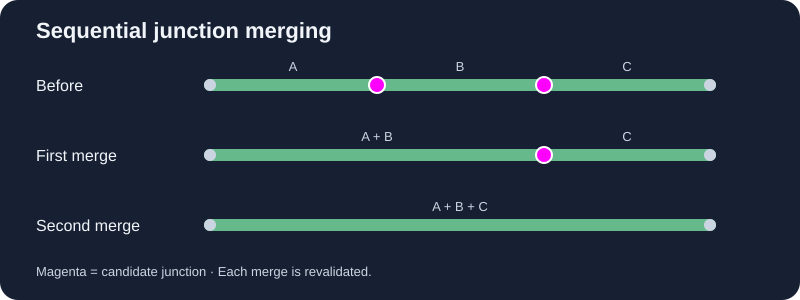
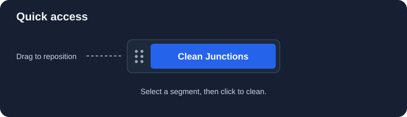

# WME Junction Cleaner

A lightweight userscript for Waze Map Editor (WME) that highlights candidate junction nodes and helps remove redundant junctions by merging compatible road segments.

*Illustration of the merging process; not a WME screenshot.*

## Features

- Highlights junction nodes connecting exactly two distinct segments.
- Detects compatible chains starting from a selected segment.
- Merges two segments at a time, revalidating each junction before merging.
- Provides a draggable floating **Clean Junctions** button with a persistent position and status messages.
- Includes a JC sidebar tab and refreshes highlights after map edits.
- Uses the official WME SDK and does not automatically save edits.

## Installation

1. Install [Tampermonkey](https://www.tampermonkey.net/).
2. Open [Waze Map Editor](https://www.waze.com/editor).
3. In Tampermonkey, create a new script and paste the contents of `WME-Junction-Cleaner.user.js` from this repository.
4. Save the userscript and reload WME.

A Greasy Fork installation link can be added once the script is published there.

## Usage

1. Select a single road segment.
2. Click **Clean Junctions** on the floating control or in the JC sidebar tab.
3. Review the proposed chain and confirm the operation.
4. Inspect all resulting edits before saving them in WME.

Drag the handle next to the floating button to reposition it. Its position is stored locally in your browser.

*Conceptual illustration of the floating control.*

## Safety and limitations

- Highlighted nodes are candidates, not guaranteed removable junctions.
- The current compatibility checks are conservative and limited to two-way segments. They check road attributes, speed limits, restrictions, closures, house numbers, lanes, turn guidance and other special conditions.
- A failed merge stops the chain. Earlier successful merges may remain as pending edits; review or undo them as appropriate.
- The script does not replace editor judgment. Follow local mapping guidelines and Waze editing rules.
- This is beta software. Not all road configurations, permissions or WME environments have been tested.

## Development

The project is a standalone JavaScript userscript. No build step is required. See the [WME SDK documentation](https://www.waze.com/editor/sdk/) and [changelog](CHANGELOG.md).

To contribute, open an issue or pull request. For bug reports, include the script version, browser, steps to reproduce, and relevant console errors. Avoid sharing private information.

## License

[MIT](LICENSE) — LeonerNinja.

This is an independent community project, not an official Waze product.
